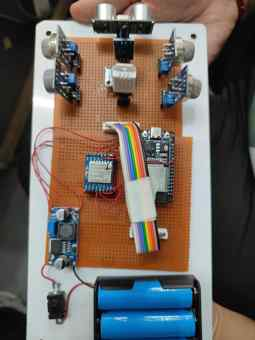
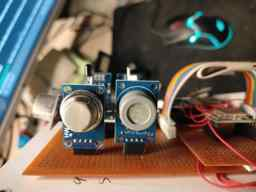

# AHARR — Atmospheric Hazard and Reconnaissance Rover


**AHARR (Atmospheric Hazard and Reconnaissance Rover)** is a low-cost, four-wheel-drive, teleoperated rover designed to perform preliminary sensing in confined industrial spaces such as storage tanks, pipelines, and enclosed process chambers before personnel enter.

The rover separates its functions across an ESP32 sensing node, ESP32 drive node, ESP32-CAM video node, and ESP32 LoRa base station. Sensor packets are sent over a 433 MHz SX1278 LoRa link. The base station emits a machine-readable serial packet for the operator dashboard and can forward the same packet to Google Sheets through Google Apps Script.

> **Safety:** AHARR is a student research prototype. It is not a certified gas detector, an explosion-protected robot, or a substitute for a confined-space entry program. Raw MQ ADC counts are not gas concentrations. Never use the rover or this dashboard to decide that a space is safe to enter.

## Table of contents

- [Project overview](#project-overview)
- [System architecture](#system-architecture)
- [Hardware](#hardware)
- [Firmware](#firmware)
- [Operator dashboard](#operator-dashboard)
- [Telemetry format](#telemetry-format)
- [Getting started](#getting-started)
- [Repository layout](#repository-layout)
- [Bench results](#bench-results)
- [Known limitations and safety](#known-limitations-and-safety)
- [Test plan](#test-plan)
- [Roadmap](#roadmap)
- [Budget and documentation](#budget-and-documentation)
- [Team and acknowledgements](#team-and-acknowledgements)
- [Security](#security)
- [License and citation](#license-and-citation)

## Project overview

Confined industrial spaces can contain combustible or toxic gases and oxygen-deficient atmospheres that are not visible to personnel. AHARR is intended to let an operator inspect a location remotely, observe live camera footage, and review sensor telemetry before deciding what further inspection or certified measurement is required.

The current prototype provides:

- Four-channel MQ raw-ADC sensing (MQ-2, MQ-5, MQ-9, and MQ-135).
- DHT22 temperature and humidity measurement.
- Flame input, advisory ultrasonic distance, and MPU6050 acceleration / angular-rate telemetry.
- Wi-Fi teleoperation through the drive node's access point.
- ESP32-CAM MJPEG video.
- SX1278 LoRa telemetry from sensing node to base station.
- USB serial telemetry to the local dashboard and optional Google Sheets logging.

The prototype is **teleoperated**. Wheel odometry, autonomous navigation, validated hazard mapping, calibrated ppm output, oxygen measurement, and hydrogen-sulphide measurement are not implemented in the current hardware configuration.

## System architecture

```text
                         OPERATOR LAPTOP
           dashboard/dashboard_live.html (Chrome / Edge)
          USB Web Serial 115200 baud       Wi-Fi control + MJPEG
                    |                              |
          +---------v----------+           +-------v-----------+
          | BASE STATION       |           | DRIVE NODE        |
          | ESP32 + Ra-02 RX   |           | ESP32 + L298N     |
          | Adds RSSI / SNR    |           | 4WD motor control |
          | USB JSON + HTTPS  |           | AP: 192.168.4.1   |
          +---------^----------+           +-------+-----------+
                    |                              | same AP
                LoRa 433.5 MHz                     |
             60-byte SensorPacket                 |
                    |                       +------v-----------+
          +---------+----------+            | ESP32-CAM        |
          | SENSING NODE       |            | OV2640           |
          | ESP32 + Ra-02 TX   |            | 192.168.4.2      |
          | MQ / DHT / IMU     |            | MJPEG :81/stream|
          +--------------------+            +------------------+
                    |
          Base station cloud uplink
                    |
          Google Apps Script -> Sheet1
```

### Node responsibilities

| Node | Board / modules | Responsibility |
|---|---|---|
| Sensing node | ESP32 DevKit + Ra-02 | Samples MQ-2 / MQ-5 / MQ-9 / MQ-135, DHT22, flame input, HC-SR04, and MPU6050; transmits a packed packet about every 3 seconds |
| Drive node | ESP32 DevKit + L298N | Creates the `ESP32_CAR` Wi-Fi AP, serves movement endpoints, controls four geared motors, and stops when movement commands time out |
| Camera node | AI-Thinker ESP32-CAM / OV2640 | Joins the rover AP at `192.168.4.2`, serves still capture on port 80, and MJPEG on port 81 |
| Base station | ESP32 DevKit + Ra-02 | Receives LoRa packets, adds RSSI / SNR, emits `AHARR:{...}` over USB serial, and posts telemetry to Google Apps Script when its uplink is available |

The intended drive-node AP address is `192.168.4.1`. The camera firmware assigns `192.168.4.2` on that network.

## Hardware

### Implemented sensor channels

| Component | Purpose | ESP32 sensing GPIO / interface |
|---|---|---|
| MQ-2 | Smoke and combustible gas response | GPIO 34 / ADC1 |
| MQ-5 | LPG / natural gas response | GPIO 35 / ADC1 |
| MQ-9 | CO / combustible gas response | GPIO 32 / ADC1 |
| MQ-135 | Air-quality gas response | GPIO 33 / ADC1 |
| Flame module (LM393) | Digital flame indication | GPIO 25 |
| HC-SR04 | Advisory forward-distance measurement | TRIG 26 / ECHO 27 |
| DHT22 | Temperature and humidity | GPIO 4 |
| MPU6050 | Acceleration and angular rate | I²C SDA 21 / SCL 22 |
| Ra-02 / SX1278 | LoRa transmit / receive | SPI: SCK 18, MISO 19, MOSI 23, NSS 5, RESET 14, DIO0 2 |

**Sensor revision note:** the current firmware and telemetry packet use MQ-2, MQ-5, MQ-9, and MQ-135. MQ-7 was marked “not used” in the supplied BOM and appeared in the earlier dashboard mock-up; it is not a live channel in this firmware. The fourth channel is MQ-135.

### Hardware photographs

These compressed photographs show the actual project assemblies supplied for documentation. They are not exterior side/front views of a complete assembled rover.

| Drive assembly | Sensing deck | Gas sensor modules |
|---|---|---|
|  |  |  |

### Drive node pins

| Function | L298N pin | ESP32 GPIO |
|---|---|---:|
| Left motor direction | IN1 / IN2 | 26 / 27 |
| Left motor speed | ENA (PWM) | 33 |
| Right motor direction | IN3 / IN4 | 14 / 25 |
| Right motor speed | ENB (PWM) | 32 |
| Auxiliary light | — | 4 |

Remove the ENA / ENB jumpers when using ESP32 PWM control. Confirm motor direction and wheel wiring with the rover raised and at low PWM before placing it on the floor.

### Radio configuration in firmware

| Parameter | Current firmware setting |
|---|---|
| Module | Ra-02 / SX1278 |
| Frequency | 433.5 MHz |
| Spreading factor | SF7 |
| Bandwidth | 125 kHz |
| Coding rate | 4/5 |
| TX power setting | `LoRa.setTxPower(10)` |
| Packet | 60-byte packed structure, magic `0xABCD` |
| Nominal interval | Approximately 3.1 seconds |

The 433.5 MHz / 10 dBm code setting follows the project update plan, but it does **not by itself establish regulatory compliance**. Confirm the currently applicable frequency, antenna gain, effective radiated power, and local radio requirements before transmitting. The antennas and RF setup must also be physically verified.

## Firmware

The Arduino sketches are arranged so each main `.ino` filename matches its containing folder name, which is required for a normal Arduino sketch folder.

| Sketch | Board | Main tasks |
|---|---|---|
| [`firmware/sensing_node/sensing_node.ino`](firmware/sensing_node/sensing_node.ino) | ESP32 sensing node | Reads sensors, applies a 3-sample moving average to MQ channels, estimates gyro zero-rate offsets at startup, and transmits LoRa packets |
| [`firmware/base_station/base_station.ino`](firmware/base_station/base_station.ino) | ESP32 base station | Receives and validates packets, attaches RSSI / SNR, prints an `AHARR:` JSON line over USB serial, and posts to Google Apps Script with a 2.5 s HTTP timeout and response-body status check |
| [`firmware/drive_node/drive_node.ino`](firmware/drive_node/drive_node.ino) | ESP32 drive node | Hosts the rover AP and HTTP movement endpoints; retains the 500 ms command timeout and restricts browser-origin control to the documented local dashboard origins |
| [`firmware/camera_node/camera_node.ino`](firmware/camera_node/camera_node.ino) | AI-Thinker ESP32-CAM | Initializes the OV2640 and joins the rover AP at `192.168.4.2` |
| [`firmware/camera_node/app_httpd.cpp`](firmware/camera_node/app_httpd.cpp) | ESP32-CAM | Provides `/capture` on port 80 and `/stream` MJPEG on port 81 |

### Firmware changes included

- Both LoRa nodes use `433.5E6` and `LoRa.setTxPower(10)` rather than the previous 433.000 MHz / 17 dBm settings.
- Wi-Fi credentials and the Apps Script deployment URL are read from local `secrets.h` files; real values are not committed.
- The sensing node interprets the flame input as active-LOW (`1` means detected). **Verify this polarity against the physical sensor module before relying on the flag.**
- MPU6050 gyro bias is sampled over 100 startup reads; keep the rover stationary during this approximately one-second calibration.
- MQ channels are smoothed with a 3-sample moving average. Values remain raw ADC counts.
- The base station emits one line beginning `AHARR:` followed by JSON, even when the cloud uplink is unavailable. The dashboard reads that line over USB serial.
- Google Apps Script responses are checked for `"status":"success"`; an HTTP 200 with an application-level error is no longer reported as a successful write.
- The base station HTTP timeout is set to 2500 ms. The upload remains synchronous, so a slow request can still delay the next LoRa receive cycle.
- Drive-node browser control accepts the documented dashboard origins `http://localhost:8000` and `http://127.0.0.1:8000`; requests from other browser origins are rejected and private-network preflight is handled. Requests with no `Origin` header are still allowed for local diagnostics, so this is not authentication; keep the AP password protected.
- The web console refreshes movement commands while a direction key/button is held so the 500 ms watchdog does not stop a valid held command prematurely.

### Libraries

Install the ESP32 board package in Arduino IDE or PlatformIO. The sketch dependencies are:

- Sandeep Mistry `LoRa` library (project target: 0.8.0).
- Adafruit `DHT sensor library` (1.4.x series) and its required sensor dependency.
- ESP32 Arduino core libraries: `WiFi`, `WebServer`, `HTTPClient`, `SPI`, `Wire`, `esp_camera`, `esp_http_server`, and image conversion support.
- MPU6050 is read using raw `Wire` register access in the sensing sketch; no separate MPU6050 library is required.

The exact installed ESP32 core / library versions were not recorded in the supplied source archive. Record the versions used for a successful board build in the release notes.

## Operator dashboard

The live hardware dashboard is [`dashboard/dashboard_live.html`](dashboard/dashboard_live.html). It is a self-contained HTML/CSS/JavaScript page with no Tailwind CDN, Google Fonts, external scripts, or network-hosted assets, so the page styling works offline on the rover AP.

### Dashboard panels

- **Gas telemetry:** MQ-2, MQ-5, MQ-9, and MQ-135 raw ADC counts, reference thresholds, and a 30-packet trend chart.
- **Ambient / motion:** DHT22 temperature and humidity, HC-SR04 distance, flame input, MPU6050 acceleration and gyroscope, and packet metadata.
- **Link health:** packet count, mean receive interval, packet age, RSSI, and SNR.
- **Camera:** MJPEG stream at `http://192.168.4.2:81/stream` (240 × 240).
- **Teleoperation:** forward / backward / left / right / stop, speed PWM, light toggle, keyboard controls, browser-focus stop, and an emergency-stop command button. Serve the page from `http://localhost:8000` or `http://127.0.0.1:8000` for drive controls to pass the drive-node origin allowlist.
- **Event log / CSV:** only received packets and live threshold / flame events are logged; the browser can export received samples.

The dashboard does not invent battery level, odometry, oxygen, hydrogen sulphide, thermal imaging, or autonomous-navigation metrics because those fields are not available in the current packet or implemented hardware.

### Thresholds

The prototype reference thresholds are uncalibrated raw ADC counts and are used only as dashboard monitoring markers:

| Channel | Reference threshold |
|---|---:|
| MQ-2 | 450 |
| MQ-5 | 380 |
| MQ-9 | 450 |
| MQ-135 | 350 |

These values are not ppm, %LEL, occupational exposure limits, or certified alarm thresholds. A reading below a threshold does not mean an atmosphere is safe.

## Telemetry format

The sensing and base-station sketches use the same packed 60-byte `SensorPacket`:

| Group | Fields |
|---|---|
| Header | `magic`, `source`, `destination`, `packetID`, `ttl` |
| Gas | `mq2`, `mq5`, `mq9`, `mq135` (raw ADC counts) |
| Environment | `fire`, `distance` (cm), `temperature` (°C), `humidity` (%) |
| Motion | `ax`, `ay`, `az` (g); `gx`, `gy`, `gz` (°/s) |
| Link quality | `rssi` (dBm), `snr` (dB), appended by the base station |

The base station sends a serial line in this format:

```text
AHARR:{"source":1,"destination":2,"packetID":1,"ttl":3,"mq2":...,"mq5":...,"mq9":...,"mq135":...,"fire":0,"distance":...,"temperature":...,"humidity":...,"ax":...,"ay":...,"az":...,"gx":...,"gy":...,"gz":...,"rssi":...,"snr":...}
```

The dashboard parser ignores non-`AHARR:` diagnostic lines and parses the JSON payload after the prefix.

## Getting started

### 1. Prerequisites

- Arduino IDE 2.x or PlatformIO with the ESP32 board package.
- Node.js only if you also want to run the separate React/Vite UI prototype in the repository root. That React app uses sample data; the live hardware console is `dashboard/dashboard_live.html`.
- Chrome or Edge with Web Serial API support for the live dashboard.
- A Google Sheet and Google Apps Script deployment if cloud logging is required.
- Correct antennas on both Ra-02 modules and correctly rated power / voltage interfaces.

### 2. Configure credentials

There are three local secret templates:

- `firmware/base_station/secrets.example.h`
- `firmware/drive_node/secrets.example.h`
- `firmware/camera_node/secrets.example.h`

For each folder, copy `secrets.example.h` to `secrets.h` and fill in the new local values. `secrets.h` is ignored by Git. Do not commit it.

- Base station: phone hotspot SSID / password and the **new** Apps Script `/exec` URL.
- Drive node: rover AP SSID and a new strong rover AP password.
- Camera node: the same rover AP SSID / password as the drive node.

The earlier firmware source archive contained hard-coded credentials and an Apps Script URL. The currently committed sketches read credentials from ignored local `secrets.h` files, and the tracked `secrets.example.h` files contain placeholders only. Rotate any credentials that may have been shared and redeploy Apps Script before using the updated firmware. I cannot change your phone hotspot settings or deploy an Apps Script on your behalf.

### 3. Deploy Google Apps Script (optional cloud logging)

1. Create a Google Sheet and ensure the target worksheet is named `Sheet1`.
2. Open [Apps Script](https://script.google.com/), paste [`apps-script/Code.gs`](apps-script/Code.gs), and save.
3. Deploy as a web app. Set the execution identity and access scope according to your institution's policy.
4. Copy the resulting `/exec` deployment URL into `firmware/base_station/secrets.h` as `APPS_SCRIPT_URL`.
5. Test with a sample packet and confirm the JSON response contains `"status":"success"` and that a row is added to `Sheet1`.

Header row for `Sheet1`:

```text
Timestamp,Source,Destination,PacketID,TTL,MQ2,MQ5,MQ9,MQ135,Fire,Distance,Temperature,Humidity,ax,ay,az,gx,gy,gz,RSSI,SNR
```

Do not paste the live deployment URL into source code, issues, or documentation.

### 4. Flash the boards

Use the Arduino IDE and the corresponding sketch folder:

1. `firmware/sensing_node/` → sensing ESP32 DevKit.
2. `firmware/base_station/` → base-station ESP32 DevKit.
3. `firmware/drive_node/` → drive ESP32 DevKit.
4. `firmware/camera_node/` → AI-Thinker ESP32-CAM; enable PSRAM and select an appropriate partition scheme.

Ensure the matching local `secrets.h` exists in each folder that includes it. Keep the sensing node stationary while its MPU6050 gyro bias calibration runs. Allow the MQ sensors to warm up according to their datasheets and your documented test procedure.

### 5. Connect the rover and dashboard

1. Power the rover decks and verify the sensing / drive nodes start without faults.
2. Join the laptop to the rover Wi-Fi AP (`ESP32_CAR`). The camera should join the same AP at `192.168.4.2`.
3. Connect the base station USB serial port to the laptop.
4. From the repository root, start a local static server:

   ```bash
   python -m http.server 8000
   ```

5. Open `http://localhost:8000/dashboard/dashboard_live.html` in Chrome or Edge. `localhost` provides a secure context for the Web Serial API.
6. Click **Connect Node 2**, select the base-station serial port, and connect at 115200 baud.
7. Click **Start Feed** for the ESP32-CAM. Confirm that telemetry age, packet count, RSSI / SNR, and sensor values update.
8. Test the drive controls with the rover raised and the motor PWM set low before driving on the floor.

The base station uses the phone hotspot for internet uplink to Google Sheets; the operator laptop remains connected to `ESP32_CAR` for camera and drive control.

## Repository layout

```text
industrial-safety-rover/
├── README.md
├── CITATION.cff
├── .gitignore
├── .github/
│   └── workflows/
│       └── secret-scan.yml
├── apps-script/
│   └── Code.gs
├── dashboard/
│   └── dashboard_live.html
├── firmware/
│   ├── sensing_node/
│   │   └── sensing_node.ino
│   ├── base_station/
│   │   ├── base_station.ino
│   │   └── secrets.example.h
│   ├── drive_node/
│   │   ├── drive_node.ino
│   │   └── secrets.example.h
│   └── camera_node/
│       ├── camera_node.ino
│       ├── app_httpd.cpp
│       ├── camera_pins.h
│       └── secrets.example.h
├── hardware/
│   ├── bom.csv
│   └── schematics/       # pending EasyEDA source / PDF / PNG exports
└── docs/
    ├── README.md
    ├── images/
    └── test_plan.md
```

The legacy React/Vite dashboard source remains in `src/` as a UI prototype and currently uses local demonstration data. Use `dashboard/dashboard_live.html` for the live USB / Wi-Fi hardware console.

## Bench results

The update notes for the **3 November 2026** bench run report:

| Measure | Reported result |
|---|---|
| LoRa packets | 9/9 received in the recorded run |
| Mean packet interval | 3.15 seconds |
| RSSI | Approximately −118 to −122 dBm; antenna setup was suspected |
| MQ-135 | Clipped at 4095 counts for 3 packets |
| MQ-9 | Read 0 in the recorded run |
| Flame input | Flag polarity appeared inverted; firmware now treats the input as active-LOW pending physical verification |

The original `readings_2026-11-03T06-14-52.csv` file was not among the available source files, so the figures above are transcribed from the supplied update plan and have not been independently recalculated. The raw CSV should be added under `data/` unchanged when it is available. Do not replace it with generated sample data.

## Known limitations and safety

### Sensors and measurement

- MQ values are raw ADC counts, not ppm or %LEL. Calibration curves, load-resistor values, heater behavior, temperature / humidity compensation, and cross-sensitivity must be characterized before quantitative interpretation.
- The current `MQ-9` test channel previously returned zero; investigate sensor power, wiring, and GPIO32 before relying on it.
- The `MQ-135` channel previously clipped at 4095; verify the output voltage and add an appropriate divider / signal-conditioning stage before connecting a 5 V module output to a 3.3 V ESP32 ADC input.
- The flame flag is inverted in firmware based on the bench observation; verify the actual module polarity with no flame and with a controlled flame source.
- The HC-SR04 is advisory and does not implement obstacle braking.
- The firmware averages three MQ samples. This filters some noise but does not calibrate the sensors.

### Electrical and mechanical

- Verify suitable voltage dividers / level protection for every MQ analog output and the HC-SR04 ECHO line before operation.
- Fit and validate a battery management / protection solution for the 18650 packs.
- Drive is open-loop; there are no wheel encoders or odometry.
- The rover electronics are not enclosed or explosion-protected.

### Communication and availability

- Wi-Fi range may deteriorate inside metal tanks and other enclosed structures.
- Poor bench RSSI (−118 to −122 dBm) requires antenna seating, antenna suitability, and link-budget checks.
- The base station performs synchronous cloud upload with a 2.5-second timeout; a slow upload can delay its next receive cycle.
- LoRa power and frequency must be checked against current local regulations and actual antenna gain / e.r.p.

### Dashboard

- The live HTML dashboard depends on USB Web Serial for sensor telemetry; it does not fetch sensor data directly from Google Sheets.
- Camera access requires the laptop to be joined to the rover AP and the camera to be at `192.168.4.2`.
- Dashboard threshold markers are for prototype observation only. They are not safety limits.

## Test plan

The verification checklist is in [`docs/test_plan.md`](docs/test_plan.md). It includes power rails, sensor input protection, gas response, flame polarity, IMU calibration, LoRa link, Apps Script upload, Web Serial telemetry, camera feed, drive control, watchdog, and endurance. Result fields remain blank until tests have actually been carried out.

## Roadmap

- [ ] Add and verify the actual schematic source and PDF / PNG exports under `hardware/schematics/`.
- [ ] Add the original 3 November 2026 bench CSV without modification.
- [ ] Add the final capstone report after placeholders and incomplete sections are resolved and student identifiers are reviewed for publication.
- [ ] Complete electrical voltage-divider / level-protection work and update the wiring diagrams.
- [ ] Resolve MQ-9 zero readings and MQ-135 saturation; document calibration data.
- [ ] Measure RSSI again after antenna installation and check the LoRa link budget.
- [ ] Validate flame sensor polarity on the physical module.
- [ ] Confirm local radio compliance with the final antenna and output power.
- [ ] Add LoRa acknowledgements / retries or a queued cloud-upload path if packet reception is affected by HTTP latency.
- [ ] Add wheel encoders, odometry, obstacle handling, and tilt warnings.
- [ ] Evaluate dedicated O₂-deficiency and H₂S sensors if those hazards are in scope.
- [ ] Run and record every item in `docs/test_plan.md`.

## Budget and documentation

The supplied proposal cost-analysis form lists a total estimated budget of **₹12,545**. The line-item values and status notes are retained in [`hardware/bom.csv`](hardware/bom.csv). The original cost-analysis document has not been altered. A copy is not included in the public source tree because its signature page contains team roll numbers; publish a redacted copy only if the team approves.

The final capstone report PDF, schematic source project, schematic exports, and raw bench CSV were not present in the files available for this update. The repository does not claim that those missing deliverables have been uploaded.

## Acknowledgements

Developed as a student research prototype in the Electrical & Instrumentation Engineering Department, Thapar Institute of Engineering and Technology, Patiala.

**Supervisor:** Dr. Parag Nijhawan, Electrical & Instrumentation Engineering Department.

The camera module uses Espressif's `esp_camera` driver and ESP-IDF HTTP server APIs. Retain applicable upstream notices for any third-party source files copied into the project.

## Security

- Never commit `secrets.h`, Wi-Fi passwords, or the real Google Apps Script URL. The root `.gitignore` excludes all `secrets.h` files.
- The prior source archive contained hard-coded AP / hotspot credentials and a deployment URL. Rotate those credentials and redeploy Apps Script before using the updated firmware.
- If credentials were ever pushed to GitHub, treat them as exposed. Revoke / rotate them first, then coordinate a history rewrite with collaborators. Do not force-push history without confirming the exact affected commits and warning collaborators.
- A GitHub Actions Gitleaks workflow is included. Also enable GitHub Secret Scanning and Push Protection in repository Settings → Security / Code security; this setting must be enabled in GitHub's repository UI.
- Do not put secrets in screenshots, issue text, commits, or test logs.

## License and citation

No license file is included yet. Confirm that the department and all project contributors approve the licensing terms before publishing a license or accepting external reuse. Public repository visibility does not by itself grant permission to reuse the work.

Citation metadata is provided in [`CITATION.cff`](CITATION.cff).